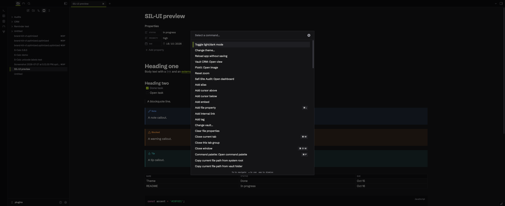
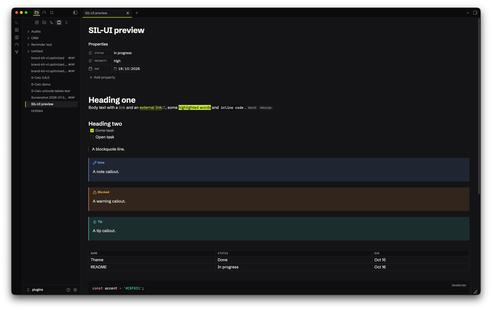
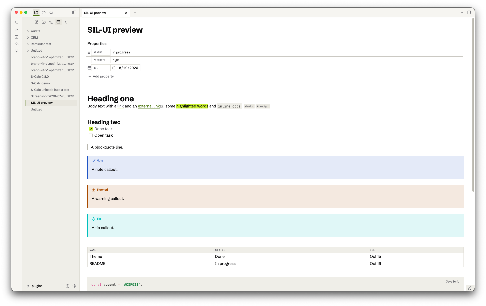

# SIL-UI

Safi Ink Lime UI. A dense, square Obsidian theme built on the ink and lime style from [mdk (MD Kanban)](https://github.com/Abdulkader-Safi/md-kanban-v2). Near-black ink surfaces, one lime accent, 1px hairlines, no rounded corners and no shadows. A warm paper light mode mirrors the dark one.

| Dark theme                                     | Light theme                                      |
| ---------------------------------------------- | ------------------------------------------------ |
|  |  |

## Both modes

Dark is ink: app `#0B0B0C`, sidebars `#0F0F11`, notes `#141416`, hover and selected rows `#1E1E22`, hairlines `#2A2A2F`. Text is `#F2F2EE` with muted `#9B9BA3`.

Light is paper: app `#F6F5F1`, sidebars `#EFEEE8`, notes `#FFFFFF`, raised rows `#E8E6DE`, hairlines `#DCDAD2`. Text is `#0B0B0C` with muted `#5F5F66`.

Lime `#C8F031` with ink text fills the primary button, ticked checkboxes, toggles that are on and highlights. Lime fails contrast as text on paper, so in light mode links, focus rings and selected-row edges use dark green `#3F6B00`.

Switch modes under Settings > Appearance > Base color scheme.

## What you get

- Square corners everywhere, plugins included. Regions are split by 1px hairlines; depth comes from surface steps, never shadows.
- The active tab has a 2px lime underline. The selected file, settings section and command palette row are raised with a 2px lime left edge.
- Machine text is set in JetBrains Mono: the view header path, property keys, table headers, tags, file-type badges, key hints and the status bar. Property keys and table headers are small tracked caps.
- Callouts get a 2px left rule in their colour and a 12% tint. Callout colours come from the mdk status set (blue, amber, green, purple, red).
- Buttons are outlines; the primary button is lime. Inputs are hairline boxes that turn lime (dark green on paper) on focus.
- Tables fill the content width, and the readable line length goes up to 1600px.
- H6 is a small uppercase label, for section captions inside notes.

## Fonts

Schibsted Grotesk for UI and body text, JetBrains Mono for code and machine text. Both are embedded in `theme.css` (Latin subset, SIL Open Font License), so the theme works offline and makes no network calls. Fallbacks are Inter then system-ui, and ui-monospace then Menlo.

## Install

1. Copy the `SIL-UI` folder into your vault at `.obsidian/themes/SIL-UI`. The folder name must match the `name` in `manifest.json` exactly, or Obsidian won't list it.
2. In Obsidian, open Settings > Appearance > Themes and pick **SIL-UI**. If it doesn't appear, reload Obsidian.

## Customise

The colour tokens sit near the top of `theme.css`, under `.theme-dark` and `.theme-light` (`--sil-bg-app`, `--sil-accent-bg`, `--sil-accent-text` and so on). A shared block below maps them onto Obsidian's own variables, so to retheme you only edit the tokens.

To swap the accent, change `--sil-accent-bg` and `--sil-accent-bg-hover` to another saturated colour that keeps 4.5:1 with ink text on it, and set the light `--sil-accent-text` to a dark shade of it that keeps 4.5:1 on white.

If a plugin needs round shapes, delete the `border-radius: 0 !important` catch-all in `theme.css`.

## Support

If this theme is useful, you can support the work at [ko-fi.com/abdulkadersafi](https://ko-fi.com/abdulkadersafi).
